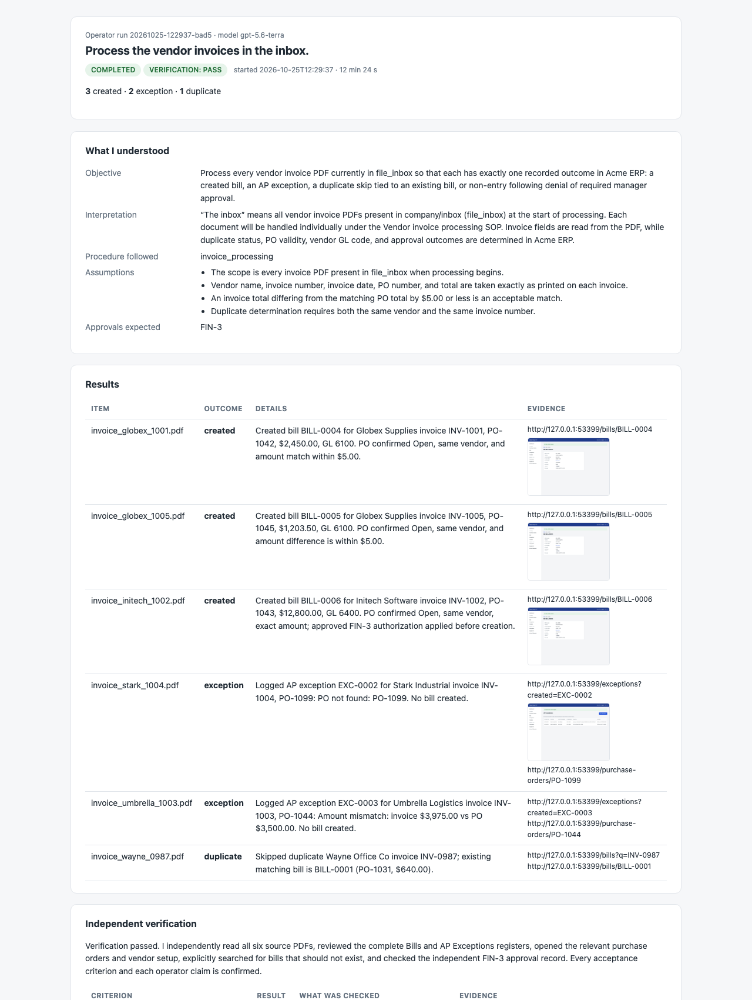
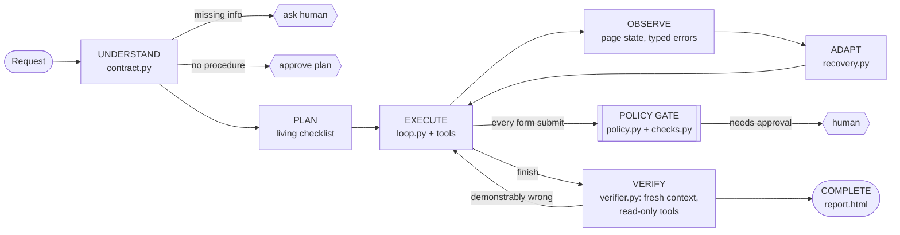

# Acme Operator: an AI employee that does the work, and proves it

You ask in one line: *"Process the vendor invoices in the inbox."* The operator then:
- reads the company's own procedures to work out what "done" means
- reads the PDFs and works through a web ERP in a real browser, the way a person would
- pauses for a manager's approval where policy says so
- recovers when the app misbehaves
- has an **independent verifier** check the result against the real system
- hands back an **evidence report**

The same runtime onboarded a new employee with **zero code changes**: only the handbook is different.

> A narrow system that genuinely demonstrates autonomy. Every claim below is backed by a test, an eval
> scenario graded from the database, or a run log.


A real run, with chaos mode on (buttons renamed, sessions expiring, random 500s):
```
✅ 3 bills created · ⚠️ 2 exceptions logged · ⏭️ 1 duplicate skipped · 👤 1 approval (FIN-3)
Verified 6/6 criteria and 6/6 claims independently · 12 recoveries (9 retried 500s, 2 expired sessions, 1 re-login)
Ground truth from the database: 14/14 checks correct
```



---

## Contents
1. [Quick start](#quick-start)
2. [How it works](#how-it-works)
3. [Key design decisions](#key-design-decisions-and-why)
4. [Results](#results)
5. [What the evals found (and what I changed)](#what-the-evals-found-and-what-i-changed)
6. [Adding a new kind of work, with no code](#adding-a-new-kind-of-work-with-no-code)
7. [Known limitations](#known-limitations)
8. [What I'd build next](#what-id-build-next)
9. [Assumptions](#assumptions)
10. [Models, APIs and libraries](#models-apis-and-libraries)
11. [Repo map](#repo-map)

---

## Quick start

Requirements: macOS or Linux, Python 3.12, an OpenAI API key.

```bash
git clone <this-repo-url> && cd <repo-folder>
make setup                 # venv + dependencies + Playwright Chromium; creates .env from .env.example
# edit .env: OPENAI_API_KEY and AGENT_MODEL / VERIFIER_MODEL (e.g. gpt-5.5)
make reset                 # fresh sandbox DB + the six invoice PDFs
make sandbox               # terminal 1: the "Acme ERP" on http://localhost:8000 (user agent / acme-demo-123)
make demo-invoices         # terminal 2: watch it work (the browser is visible; approve FIN-3 when asked)
```

For the `python -m agent …` commands below, first activate the environment: `source .venv/bin/activate`.

One invoice run takes about 5–8 minutes (longer with chaos on) and about 1.3M input tokens. The full step-by-step guide, with what you'll see, the expected results and troubleshooting, is in [`run.md`](run.md).

| Command | What it does |
|---|---|
| `make sandbox-chaos` | The same ERP with failure injection: renamed buttons, session expiry, random 500s, slow pages (seeded) |
| `make demo-onboarding` | Onboard Priya Sharma: same runtime, different handbook entry |
| `python -m agent run "<request>" [--human terminal\|file\|auto-approve\|auto-deny] [--headless]` | Any request in plain language |
| `python -m agent resume <run> --approve \| --deny \| --answer "..."` | Continue a run that paused for a human (`--human file`); it may be hours later, in a new process |
| `python -m agent verify <run>` | Re-check a finished run against the system **as it is now** |
| `python -m agent report <run> --open` | Open the HTML evidence report |
| `make test` | 143 tests: no API calls, real sandbox, real browser |
| `make evals` / `make evals-quick` | Scenario suite graded from the database (below) |

Every run writes `runs/<id>/`:
- `events.jsonl`: an append-only log of every model call, tool call, policy decision, approval, recovery and verification
- `state.json`: the checkpoint that resume uses
- `screenshots/`
- `report.html`

Secrets are redacted in all of them.

---

## How it works



| Stage | What happens | Where |
|---|---|---|
| **Understand** | The model reads the handbook index, opens the matching procedure (SOP), resolves dates ("this coming Monday" → 2026-10-26) and writes a **Task Contract**: objective, interpretation, assumptions, **acceptance criteria an outsider could check**, expected approvals and an initial plan. Missing details the procedure requires → it **asks before doing anything**. No matching procedure → the plan goes to a human for approval first. | `agent/contract.py`, `prompts/contract.md` |
| **Plan** | A living checklist (`update_plan`), revised whenever reality differs from the plan. | `tools/plan_tools.py` |
| **Execute** | Our own tool-calling loop on the OpenAI Responses API, with 21 tools: browser (accessibility-tree snapshots, click/fill by role and label), PDF and file read/write, handbook, credentials, calculator, ask-human, plan/outcome/finish. | `agent/loop.py`, `agent/tools/` |
| **Observe** | Every tool returns a typed result (`transient`, `not_found`, `auth`, `validation`, `policy_denied`, …) plus a message that says how to recover. Browser actions report the URL, alerts and form errors they land on. | `tools/base.py`, `tools/browser.py` |
| **Adapt** | Transient errors are retried inside the tool. The model gets candidates for renamed elements and re-authenticates on expiry. A monitor spots loops and stalls, injects a reflection, then escalates to a human. | `agent/recovery.py` |
| **Gate** | Before **any** click that submits a form, plain code (not the model): recognises the action, reads the values from the page, refuses half-filled forms, blocks repeats, **looks up facts in the system** (no duplicate, PO open, amounts match), applies deny/approval rules, and pauses for a human. | `agent/policy.py`, `agent/checks.py` |
| **Verify** | A **fresh** model conversation with its own browser and **read-only** tools sees only the contract, the operator's *claims* and the gate's approval log. It checks every criterion and claim against the live system; the verdict is computed in code from its findings. If something is demonstrably wrong, the operator repairs it (at most 2 rounds). | `agent/verifier.py` |
| **Complete** | The HTML evidence report: what it understood, the result per item, verification with screenshots, human involvement, recoveries, plan, cost and the full timeline. The run counts as `completed` **only if the verifier passes it**. | `agent/report.py` |

**Human-in-the-loop is durable.** With `--human file`, an approval or question writes `pending.json`, checkpoints and **exits** (code 3). `resume` restarts the run in a new process with a new browser, and the decision is applied when the operator redoes the paused step. Evals use exactly this path.

---

## Key design decisions (and why)

**1. Our own loop, no agent framework.**
- The loop is about 130 lines (`loop.py`), so every behaviour is explicit, testable and debuggable from the event log.
- Frameworks hide exactly the parts that matter here: when to stop, how to trim context, how a pause survives a restart.

**2. A Task Contract before acting.**
- "Done" is written down, as criteria an outsider could check, **before** the first action.
- That gives the executor a target, the verifier a checklist, and a human something to approve.
- Ambiguity is resolved here: the vague *"Onboard Priya Sharma"* asks for department, title, start date and manager **before** any record exists. The evals check this from the database at the moment of the pause.

**3. A living plan, not plan-then-execute.**
- Real systems surprise you (a laptop is in repair, a PO doesn't exist).
- The plan is a checklist the model updates as it learns, not a script it follows blindly.

**4. Accessibility-tree browser control, not pixels.**
- Playwright `aria_snapshot()` gives roles and names (`button "Create Bill"`), and actions use `get_by_role` / `get_by_label`.
- That's cheaper and more reliable than screenshots and coordinates, and it survives layout changes.
- When a button is renamed (`Create Bill` → `Save Bill` under chaos), the tool returns the buttons that *do* exist and the model re-locates the right one.
- Vision would be the fallback for apps without accessible markup.

**5. A deterministic policy gate, matched on observed facts, not on the model's word.**
- The gate recognises actions by **URL pattern + "this click submits a form"**, never by button text, so it still works after UI drift.
- It reads the values **from the page DOM**: the model can't approve its own actions or misreport an amount to dodge a rule.
- Rules (`FIN-3: bills > $10,000 need approval`, `SEC-2: never request Finance Portal`) are data in `company/policies.yaml`.
- An idempotency ledger records only **confirmed** submissions, so a retry after an error can't double-book.
- A submission that was saved but whose confirmation page expired is detected (post/redirect/get) and counted as done.

**6. Pre-submit checks for writes that can't be undone.**
- The ERP has no delete. A wrong bill is permanent; the verifier can only report it afterwards.
- For such writes, the company declares checks (AP-1: not already billed; AP-2: PO open, same vendor, amount within $5). The gate confirms them **in the system itself** before allowing the click, using a separate tab of the same session so the operator's form is left alone. It **fails closed**: if it can't look, nothing is submitted.
- The checks came straight out of the eval findings below. This is the general pattern: *instruct the model, but enforce the invariants in code.*

**7. An independent verifier, plus a repair loop.**
- The verifier gets a fresh context, a different browser context and read-only tools.
- It sees the operator's **claims**, not its reasoning, so it can't inherit its mistakes.
- Approvals can't be seen in the ERP, so the verifier uses the **gate's approval log** as the system of record. That log is written by code the operator can't touch.
- Claims are `confirmed` / `refuted` / `unverifiable`, and the overall verdict is computed in code: `fail` only for something demonstrably wrong (which triggers a repair), `partial` for "couldn't confirm" (no wasted repair).
- Tested: delete a created bill behind its back and `python -m agent verify` fails that criterion.

**8. Error handling by failure type.**
- **The tool** absorbs transient failures: retries with backoff.
- **The model** gets actionable messages for the rest: `not_found` with the available candidates, `auth` with "sign in again, then return", `validation` with the form's error text.
- **The runtime** detects repeated failure and stalls → reflection → escalation to a human.
- Recoveries are counted per type in the report.

**9. Context management that doesn't make the model forget.**
- Page snapshots are large, so older ones are trimmed, but **only snapshots the model has already seen**, and never small ones.
- One page change per turn: a batch of actions stops after the page changes, so the model never acts on a page it hasn't seen.
- *Lesson:* the first live run "invented" outcomes because unseen snapshots were being trimmed and actions were batched across pages. Both rules came from that.

**10. Handbook retrieval without a vector DB.**
- With a handful of procedures, the model picks from the index (`list_handbook` → titles, descriptions, example requests) and reads the whole SOP. Exact, cheap, explainable.
- At hundreds of documents I'd add embedding search over sections, keeping "read the whole procedure once chosen".

**11. A sandbox with chaos, instead of a real SaaS.**
- A real app can't be reset to a known state, can't be graded from its database, and can't be told to fail on demand.
- "Acme ERP" (FastAPI + SQLite, server-rendered, accessible markup) can do all three:
  - **rename**: buttons renamed
  - **expiry**: session expires every 15 requests
  - **flaky**: 15% of GETs return 500
  - **slow**: 0.5–3 s responses
- Chaos is seeded, so failures reproduce.

**12. Generalization you can verify.**
- `tests/test_no_task_leakage.py` fails if anything under `agent/` mentions invoices, bills, vendors, employees, onboarding, laptops, Acme…
- The onboarding task ran on the **unchanged** committed runtime, and passed first time.
- When new tasks exposed generic bugs, the fixes were committed separately (`f6147e4`), so the diff shows no task logic leaked in.

**13. Secrets never reach the model.**
- The model fills a password with a reference (`$secret:acme_erp.password`) that only the browser tool resolves.
- Anything sensitive is redacted from logs and reports as a backstop.

---

## Results

Each scenario does the following:
- resets the ERP
- starts the sandbox (with chaos where noted)
- runs the **real CLI** in a subprocess, answering every pause from a script through the same durable pause/resume path a person would use
- grades the end state **directly from the SQLite database and the outbox** (`evals/ground_truth.py`), independent of both the agent and its verifier

The **"agrees?"** column measures how far the system's own verification can be trusted. A *false pass* (the verifier says pass, the database says wrong) is the dangerous case.

**Final suite: 7/7 scenarios correct by ground truth · the verifier agreed 5 of 6 times · 0 false passes.**
Model: `gpt-5.6-terra` for both executor and verifier · commit `ffbaa1b` · full table and findings in [`evals/results.md`](evals/results.md).

| scenario | what it tests | ground truth | verifier | agrees? | recoveries | human | time |
|---|---|---|---|---|---|---|---|
| invoices_clean | 6 invoices: bills, exceptions, duplicate, FIN-3 approval | ✅ 14/14 | pass | ✅ | 0 | 1 | 7m44s |
| invoices_chaos | the same, with renamed buttons, session expiry, random 500s, slow pages | ✅ 14/14 | pass | ✅ | 12 | 1 | 12m25s |
| invoices_deny | the manager **denies** FIN-3: no bill may be created | ✅ 13/13 | — ¹ | — | 0 | 1 | 7m54s |
| onboarding_clean | new hire: record, laptop (skip the one in repair), IT-7, access | ✅ 12/12 | pass | ✅ | 0 | 1 | 4m15s |
| onboarding_chaos | the same, under chaos | ✅ 12/12 | partial ² | ❌ | 4 | 1 | 5m45s |
| onboarding_ambiguous | *"Onboard Priya Sharma"*: must **ask before writing anything** | ✅ 13/13 | pass | ✅ | 0 | 2 | 5m40s |
| po_export_no_sop | no procedure exists: plan approval, then an exact CSV | ✅ 5/5 | pass | ✅ | 0 | 1 | 3m02s |

1. The work was complete and correct, but the plan's usage quota ran out during verification. The harness
   marks provider errors as such and never counts them against the agent.
2. A **false alarm** (the safe direction). The contract phrased one criterion about the past ("the laptop *was*
   available"), which no system records, so the verifier wouldn't vouch for it. The database shows the work was
   right.

An earlier full suite on the smaller `gpt-5.4-mini` scored 6/7 by ground truth, with the verifier agreeing 7/7 and 0 false
passes. The failures it exposed are in the next section.

Ground-truth checks per scenario include exact amounts, GL codes and PO links for every bill, one exception per bad invoice, no re-entered duplicate, no stray records, the resolved start date, the right laptop (never the one in repair), exactly Email + CRM standard access, the exact CSV rows, and that each expected approval was decided exactly once.

---

## What the evals found (and what I changed)

Single demo runs looked perfect. Running the whole suite repeatedly on the small development model (`gpt-5.4-mini`) did not, and that's the point of evals. Every failure below was **caught by the verifier** (the run ended `partial`, never "done"). The fixes are generic and enforced in code:

| Found | Why it mattered | Fix |
|---|---|---|
| A duplicate invoice was billed again, even though the bills list on screen showed it | Paying twice; the ERP has no delete | **AP-1** pre-submit check: the gate searches the bills itself |
| Two invoices swapped outcomes: the mismatched one was billed, the fine one sent to exceptions (the model compared all POs up front and lost track) | Wrong money out | **AP-2**: the gate opens the PO and confirms the amount within $5 |
| Under chaos, a bill was booked against a **closed look-alike PO** (same vendor, same amount) | AP-2 passed: the amounts did match | AP-2 also requires PO status **Open** and the **same vendor**; the procedure now says so |
| After a resume, a half-filled submission **reused the approval** the human gave for the complete one | An approval must authorise exactly what the human saw | Approvals match exactly on action + values; the gate refuses half-filled forms before asking anyone |
| `slow` chaos delayed the health probe, so the chaos sandbox "never started" | The eval harness itself was flaky | `/health` is exempt from chaos |
| A criterion said "no bill **anywhere in the ERP** breaks tolerance", which can't be checked for old data | Verifier said `partial` on correct work (a false alarm) | Contract criteria are scoped to the records the work creates or touches |

Earlier phases had their own lessons:
- The first live run claimed outcomes it hadn't achieved (context trimming plus batched page changes).
- The model asked a human for approvals the gate already enforces (`request_approval` removed; `ask_human` refuses approval questions).
- The verifier couldn't open a second browser in the same process (one shared Playwright driver, separate contexts).

---

## Adding a new kind of work, with no code

Everything task-specific lives in `company/`:

1. **Write the procedure:** `company/sops/<name>.md`. Plain English, with front-matter (`title`, `description`, `triggers`) and a "Done when" section.
2. **Declare the actions** in `company/systems.yaml`: URL pattern, the form labels to read, and the idempotency key, so the gate recognises the writes.
3. **Add rules** in `company/policies.yaml`:
   - approvals (`require_approval`) and prohibitions (`deny`), on the values read from the form
   - **pre-submit checks** for anything irreversible

Onboarding was added this way: SOP + 3 action signatures + 3 rules (IT-7, SEC-1, SEC-2). A request with **no** procedure still works: the operator proposes a plan, a human approves it, then it runs. That's how *"Export all open purchase orders above $5,000 to a CSV"* was done, paging through three pages of POs and producing exactly the 5 matching rows.

---

## Known limitations

- **Web and files only.** No native desktop apps or email yet.
- **A sandbox, not a real enterprise app.** It's realistic in shape (login, pagination, validation, no delete, chaos), but small.
- **Policy matching depends on forms with proper labels.** Pre-submit checks depend on the system showing the facts on a page. An app with inaccessible markup would need the vision fallback.
- **The verifier uses the same model family as the executor**, so their mistakes can be correlated. Ground truth in the evals is the guard against that.
- **One run at a time; approvals via CLI/file only.** No web inbox or Slack.
- **Small handbook.** Retrieval is "pick from the index", which is right at this size but not at hundreds of SOPs.
- **Pre-submit checks prevent wrong bills, not every wrong outcome.** For example, an invoice wrongly sent to the exception queue is still only caught afterwards, by the verifier. That's lower risk: a human reviews that queue.
- **Model quality matters for long multi-item tasks.** The small model made bookkeeping slips the checks and verifier then had to catch.
- **Contracts sometimes include a criterion about the past** ("was available before…") despite the prompt rule. The verifier
  rightly won't vouch for what no system records, so correct work can end `partial` (a false alarm, the safe direction).
  Next fix: let the verifier mark such criteria "not checkable" and judge only the end state.
- **Dates are relative to the run date.** "This coming Monday" is resolved against the machine's clock, and so is the ground truth.

---

## What I'd build next

1. **Connectors beyond the browser:**
   - MCP-based connectors for real systems (Gmail, Google Sheets, an open-source ERP)
   - a desktop connector (macOS accessibility API, with vision computer use as the fallback)
2. **A web approvals inbox and Slack approvals**, on top of the existing durable pause/resume.
3. **Learned playbooks:**
   - turn successful runs and human corrections into reusable, reviewed procedure updates
   - suggest pre-submit checks from repeated verifier findings
4. **A job queue, scheduling and concurrent runs**, with per-company permission scopes.
5. **Company memory with vector search** once the handbook outgrows an index.
6. **A bigger eval suite** with N repeats per scenario, regression tracking per commit, and a different-model verifier to reduce correlated errors.

---

## Assumptions

- Today's date comes from the machine. The evals compute expected dates the same way, never hardcoded.
- Invoice amounts within **$5.00** of the PO are acceptable; the invoice amount is billed.
- A bill needs an **Open** PO from the **same vendor**, and the PO number printed on the invoice is authoritative.
- If FIN-3 approval is denied, the invoice is recorded as "not entered" (an exception is allowed but not required).
- New hires in Sales/Engineering get a MacBook Pro 14, everyone else a MacBook Air. Everyone gets Email; Sales gets CRM standard; nobody gets Finance Portal through the operator.
- The operator signs in as a service account (`agent`). Its credentials are in `.env` and never shown to the model.

---

## Models, APIs and libraries

| | |
|---|---|
| **LLM** | OpenAI **Responses API** via the official `openai` SDK (3.37), with function calling, structured outputs (Pydantic) and `reasoning.effort=medium`. Executor and verifier models are set separately in `.env` (`AGENT_MODEL`, `VERIFIER_MODEL`). Developed on `gpt-5.4-mini` (official API); the final eval suite ran on `gpt-5.6-terra`. All model access is in one adapter, `agent/llm.py`; `LLM_BASE_URL` / `LLM_API_KEY` can point it at any OpenAI-compatible endpoint (used for some development runs). |
| **Browser** | Playwright 1.64 (sync API, Chromium): accessibility snapshots, one shared driver with an isolated context per session |
| **Sandbox** | FastAPI, Jinja2, SQLite (stdlib), uvicorn |
| **Documents** | pypdf (reading invoices), reportlab (generating the sample invoices) |
| **Data and config** | Pydantic 2, PyYAML, python-dotenv |
| **Output** | Rich (live terminal UI), Jinja2 (HTML report) |
| **Tests** | pytest: 143 tests, no API calls; real sandbox server and real browser where it matters |
| **Build** | Python 3.12, `uv` (pip fallback), Make |

---

## Repo map

```
agent/                 task-agnostic runtime (a test forbids task words in here)
  cli.py                 run / resume / verify / report / runs; verify-and-repair orchestration
  contract.py            UNDERSTAND: task contract, blocking questions, plan approval
  loop.py                EXECUTE/OBSERVE/ADAPT loop; one page change per turn
  policy.py              deterministic gate: action recognition, rules, approvals, idempotency
  checks.py              pre-submit checks in the system of record (fail closed)
  recovery.py            loop/stall detection, reflection, escalation, recovery accounting
  verifier.py            independent verification with read-only tools
  human.py               terminal / durable file / scripted human channels
  llm.py                 the only file that talks to the model provider
  context.py · state.py · models.py · report.py · ui.py · config.py
  prompts/               contract.md, executor.md, verifier.md
  tools/                 browser, files, handbook, credentials, calculator, ask_human, plan/outcome/finish
company/               everything task-specific: the "employee handbook"
  systems.yaml           systems, areas, action signatures for the gate
  policies.yaml          approval/deny rules, pre-submit checks, unknown-task policy
  sops/                  invoice_processing.md, employee_onboarding.md
  inbox/ · outbox/       invoice PDFs in; exported files out
sandbox/               "Acme ERP": FastAPI app, seed data, invoice generator, chaos middleware
evals/                 scenarios.yaml, ground_truth.py (reads the DB), run_evals.py → results.md
tests/                 143 tests: gate, checks, recovery, resume, verifier, evals, no-task-leakage, …
prompt.md              the original build spec, phase by phase
```
